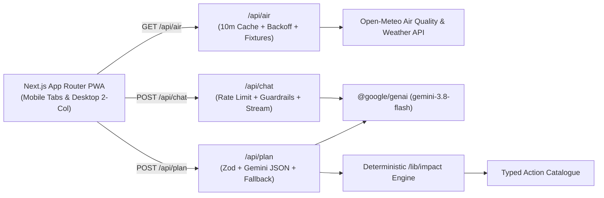

# Saans — Urban Air Quality Assistant

> **Breathe easier, one choice at a time.**  
> Google for Developers "Prompt War" — Challenge 06 entry.

Saans is a mobile-first PWA (and 2-column desktop dashboard) powered by Google Gemini and deterministic environmental physics to help families and neighbourhoods navigate severe winter smog.

## Architecture



### Trust Boundary: LLM vs. Deterministic Math
- **Gemini (`@google/genai`)** personalizes action selection from the typed catalogue (`src/lib/catalogue.ts`) and authors plain-language explanations (`headline`, `howToDoIt`, `whyItWorks`, `verdict`) plus grounded streaming Q&A.
- **Deterministic Impact Engine (`src/lib/impact.ts`)** computes **all** quantitative numbers (`indoorPm25Before`, `indoorPm25After`, `durationMinutes`, `co2SavedKg`, `confidence`) using documented infiltration ($I_f = 0.78 \rightarrow 0.52$), CADR exponential decay, and MoEFCC/DEFRA emission factors. The LLM never invents statistics.

## Key Features
- **3-Step Skippable Onboarding (<30s)**: Open-Meteo Geocoding search-as-you-type, geolocation, household sensitivity chips, lifestyle inputs, and `localStorage`-only privacy guarantee.
- **Home Dashboard**: Animated AQI gauge (`tabular-nums`), Indian CPCB categories (Good → Severe) + US EPA AQI toggle, 6-pollutant breakdown (`PM2.5`, `PM10`, `NO2`, `SO2`, `O3`, `CO`), 24h Recharts forecast highlighting the cleanest outdoor window, and per-person health advice chips.
- **Today's Plan & Impact Explainer**: Three tabs (*Low-Emission Routines*, *Indoor Air Hacks*, *Sustainable Swaps*), check-off progress ring, running "Air You Protected" tally, before/after physics breakdown modal, and **Myth Busters** (e.g., houseplants vs. winter smog, cloth masks vs. N95).
- **Ask Saans**: Streaming chat grounded in live AQI, household profile, and active plan with prompt-injection defenses and IP rate limiting.
- **Community Air Brief**: One-tap WhatsApp text copy + downloadable PNG brief card for RWAs, schools, and neighbours.
- **Smog Simulator & Bilingual UI**: Toggle **Winter Smog Simulator (AQI ~312)**, **One-Tap Demo Household**, and **English / हिन्दी** anytime.

## Local Setup

```bash
npm install
cp .env.example .env.local
# Add GEMINI_API_KEY in .env.local (optional: app gracefully falls back to rule-based plans if omitted)
npm run dev
```

## Verification Commands

```bash
npm run typecheck
npm run lint
npm run test
npm run build
npx playwright test
```

## Hardening & Documentation
- **Boot-time env validation**: `src/lib/server/env.ts` validates `GEMINI_API_KEY` and `GEMINI_MODEL` via Zod on server load.
- **API & Security Guards**: Payload byte limits (`413`), malformed JSON handling (`400`), prompt-injection sanitization, per-IP sliding-window rate limiting (`429`), and security headers in `next.config.ts`.
- **Dedicated Pages**: `/settings`, `/privacy`, `/disclaimer`, custom `not-found.tsx` (404), error boundaries (`error.tsx`, `global-error.tsx`), and dynamic `opengraph-image.tsx`.
- **Architecture & Strategy Docs**: See [docs/PROJECT_MAP.md](docs/PROJECT_MAP.md) and [docs/LAUNCH_READINESS.md](docs/LAUNCH_READINESS.md).

## Cloud Run Deployment

```bash
docker build -t saans-urban-air .
docker run -p 8080:8080 -e GEMINI_API_KEY=your_key -e GEMINI_MODEL=gemini-3.8-flash saans-urban-air
```
